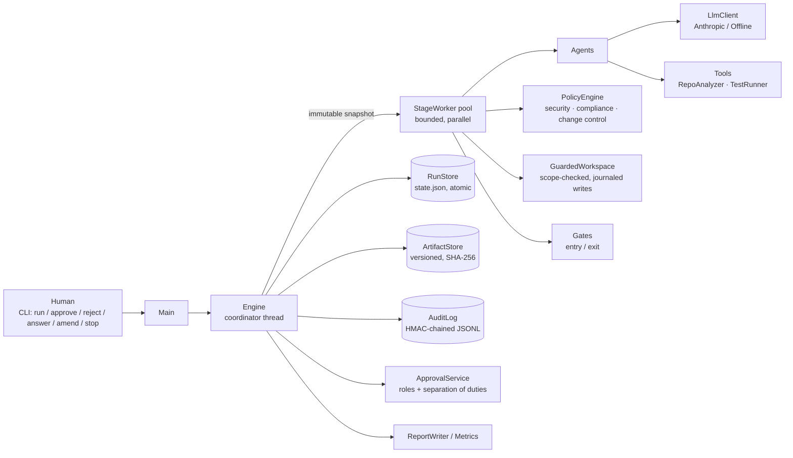
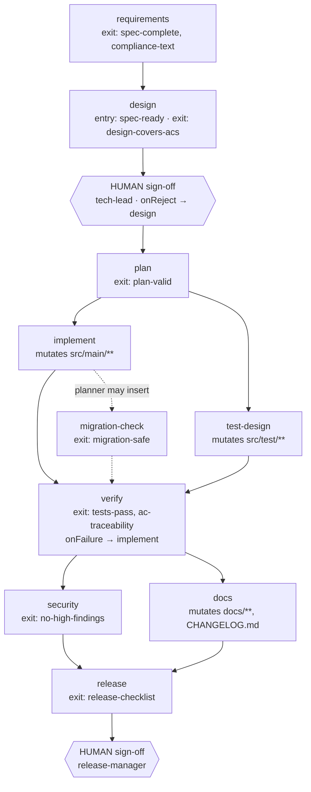

# Architecture

Two deliverables in one repository:

| Module | What it is | Stack |
|---|---|---|
| `sdlc-orchestrator/` | The **agentic engineering system**: turns a requirement into a reviewed, tested, documented change through a governed dependency graph of SDLC stages. | Java 17, **JDK only** at runtime (no third-party dependencies) |
| `url-shortener-service/` | The **system being engineered**: a production-style URL shortener. It's the reference implementation for greenfield runs and the codebase that brownfield runs change. | Java 17, Spring Boot 3.3, JPA, Flyway, Caffeine, Micrometer |

**Principle:** agents *propose*; the orchestrator *verifies*; humans *decide*. Control flow is deterministic code. Models only produce content inside a stage, and that content passes the same policies, gates and approvals as anything else.

---

## 1. Component view



| Package | Responsibility |
|---|---|
| `engine` | `Engine` (coordinator, transitions, re-planning, reliability controls), `StageWorker` (one attempt), `Outcome` |
| `workflow` | JSON workflow loader + `WorkflowValidator` (acyclic, known agents/gates, bounded retries, write scopes, valid `onReject`) |
| `model` | `StageDef` (graph node), `NodeRun` (runtime state), `RunState`, `ArtifactMeta` (lineage), `ApprovalRequest`, `Question`, `FileChange` |
| `agents` | 10 specialist agents + `Catalog` (domain knowledge) + `Playbooks` (verified change sets) |
| `gates` | 13 deterministic gates (spec-ready, design-covers-acs, plan-valid, tests-pass, ac-traceability, no-high-findings, …) |
| `policy` | Policy-as-code rules → `ALLOW / REQUIRE_APPROVAL / DENY` (+ critical flag) |
| `approval` | `ApprovalService` (role check, four-eyes, rejection comment), `ApproverRegistry` |
| `workspace` | `GuardedWorkspace` (path/scope enforcement, atomic change sets, journals, rollback) |
| `audit` | `AuditLog` (append-only, HMAC chain, fail-closed, `verify`) |
| `store` | `RunStore` (durable state), `ArtifactStore` (content-addressed versions) |
| `llm` | `LlmClient`, `AnthropicClient` (java.net.http, retries, budget), `OfflineLlm` |
| `analysis`, `tools` | `RepoAnalyzer` (endpoints, entities, migrations, impacted files), `TestRunner` (timeout, Surefire XML, XXE-hardened) |
| `report` | `Metrics` (computed from the audit trail), `ReportWriter` (`report.md`, `metrics.json`, `changes.patch`) |

---

## 2. The workflow graph

Workflows are **data** (`sdlc-orchestrator/src/main/resources/workflows/sdlc-default.json`). They are validated before anything runs, and again after every dynamic change.



- **Parallel paths with synchronization:** `implement ‖ test-design` and `security ‖ docs`. A stage becomes READY only when every dependency is done (a join).
- **Non-linear routing:**
  - `verify` failing routes back to `implement`, with the failing tests as feedback (`onFailure`).
  - A rejected design goes back to `design` with the reviewer's comment (`onReject`).
  - Both loops are bounded by `maxReworks`.
- **Dynamic re-planning:** the planner inserts `migration-check` when the design introduces a schema change, and adds the edge `verify → migration-check`. The engine validates the new graph first, and rejects proposals that would create a cycle.
- **Policy-triggered checkpoints:** any change set that policy marks `REQUIRE_APPROVAL` pauses its stage until the required roles approve.

### Stage contract (`StageDef`)
`consumes` / `produces` (lineage and least-privilege inputs) · `entryGates` / `exitGates` · `risk` · `maxAttempts` (1–5) + `backoffMs` · `approval` + `approvalRole` · `mutatesWorkspace` + `writeScope` · `onReject` / `onFailure` / `maxReworks`.

---

## 3. Execution model

### Coordinator + workers (why it is race-free)
A single **coordinator** thread owns `RunState`. Each loop it:
1. checks safe-stop conditions;
2. **reconciles lineage** (invalidates stale stages);
3. promotes ready stages;
4. launches them on a bounded pool;
5. applies the next completed `Outcome`.

Workers receive **immutable snapshots** (their declared input artifacts and feedback) and return an `Outcome`. They never touch run state. So "stage finished" and "plan changed" cannot race, and every transition is **persisted before the next one** (atomic `state.json` write).

### One attempt (`StageWorker`)
```
entry gates → agent.run() → policy review of proposed changes
   ├─ CRITICAL DENY (secret, boundary escape) ─► FATAL → safe-stop, never retried
   ├─ DENY ─► failed attempt; findings become feedback for the next bounded attempt
   ├─ REQUIRE_APPROVAL ─► proposal stored as artifact; stage AWAITING_APPROVAL (nothing written)
   └─ ALLOW ─► apply via GuardedWorkspace (journaled) → exit gates
                                                        └─ any gate fails → journal rolled back
```
Questions from an agent move the stage to AWAITING_CLARIFICATION.

### Node lifecycle
```
PENDING → READY → RUNNING → SUCCEEDED
                     ├→ RETRY_WAIT ──(backoff)──► READY        (bounded by maxAttempts)
                     ├→ AWAITING_APPROVAL ─► SUCCEEDED | READY(apply-approved) | rework
                     ├→ AWAITING_CLARIFICATION ─(answers)─► READY
                     └→ FAILED ─► onFailure rework | run compensation
SUCCEEDED → PENDING when a consumed artifact got a newer version (invalidation)
any → CANCELLED on safe-stop (→ PENDING on resume)
```

### Run lifecycle
`RUNNING → PAUSED` (waiting for a human; state on disk; `resume` continues in any later process) · `SUCCEEDED` · `FAILED` (after saga compensation) · `STOPPED` (safe-stop; completed work kept; resumable).

---

## 4. Cross-stage context and decision lineage

- **Artifacts** are versioned and **content-addressed**. A new version exists only if the SHA-256 changes. Each version records `producedBy`, `attempt`, `mode` (`llm` / `deterministic` / `fallback` / `human-approved` / `human`) and **the exact input versions** it was derived from.
- **Decision records** (decision, rationale, alternatives, inputs) are audit events emitted by agents.
- So you can trace any line of code back: code change → `code-changes@v2` → `spec@v1` + `design@v2` → design sign-off `A-2` by alice → `requirement@v1`.

### Re-planning when upstream outputs change
Before every step the coordinator checks each finished stage: *is any artifact it consumed now newer than the version it used?* If so:
- the stage is **invalidated**;
- its workspace changes are **rolled back**;
- its pending approvals are **superseded**;
- it re-runs.

Because versions only change when content changes, a stage that re-runs and produces **identical output stops the ripple** (hash short-circuit). Example from the ambiguous scenario: after the requirement was amended, `security` was **not** re-run for the spec change (it doesn't read the spec). It re-ran only later, when the test files it reviews actually changed.

Triggers: `amend` (a human changes the requirement), answers to clarifications, a rejected design reworked, a failed verify routed back to implement.

---

## 5. Governance

### Human checkpoints
| Checkpoint | Trigger | Role |
|---|---|---|
| Clarification | requirement is ambiguous | any known user (product owner) |
| Design sign-off | always (stage config) | tech-lead |
| Schema change | new Flyway migration (CHG-001) | tech-lead |
| Dependency/build change | `pom.xml` edited (CHG-002) | tech-lead |
| Security/config change | `**/security/**`, `application*.yml` (CHG-003) | security |
| Large change | > 400 changed lines (CHG-004) | tech-lead |
| File deletion | CHG-005 | tech-lead |
| Release sign-off | always (stage config) | release-manager |

**Rules enforced by `ApprovalService`:**
- the approver must hold the role;
- **separation of duties**: the run initiator cannot approve their own MEDIUM/HIGH-risk checkpoint, and policy-gated change sets are always at least MEDIUM;
- a rejection requires a comment, which becomes the rework feedback;
- a decision cannot be changed.

**Approved change sets are applied exactly as reviewed.** They are not regenerated, so what was approved is what lands.

### Policy guardrails (`PolicyEngine`)
| Group | Rules |
|---|---|
| Security | SEC-001 hard-coded secrets (**critical**) · SEC-002 `Runtime.exec`, `ProcessBuilder`, string-built SQL, TLS bypass · SEC-004 write outside stage scope (**critical**) |
| Compliance | CMP-001 requirement stores raw PII (IP, e-mail, precise location); a pseudonymised/hashed form is allowed · CMP-002 personal data in log statements |
| Change control | CHG-001 new migration → approval; editing an existing migration → deny · CHG-006 destructive DDL → deny (expand/contract) · CHG-002 dependency allow-list · CHG-003 protected paths · CHG-004 diff size · CHG-005 deletions |

Guardrails are enforced **in code**: `GuardedWorkspace` rejects any path outside the stage's `writeScope`, absolute paths, `..`, and escapes through symlinks, whatever the agent "intended".

### Prompt-injection defence (LLM mode)
- Repository and requirement text is wrapped in `<untrusted>` tags, and the system prompt forbids following instructions inside them.
- Model output must match a JSON contract, is policy-checked, and must pass the gates.
- Requirements interpretation is **constrained to catalog features**, so acceptance criteria always map to real tests.
- LLM security findings are **advisory and capped at MEDIUM**: a model can neither block nor clear a release.

---

## 6. Reliability controls

| Control | Implementation |
|---|---|
| Bounded retries | `maxAttempts` (validated 1–5), exponential backoff `backoffMs·2^(n-1)`, previous error passed as feedback |
| Fallback | LLM-capable agents (requirements, design, implementation, security) retry once in deterministic mode after model attempts are exhausted; the LLM client itself is fail-closed (empty → deterministic path) |
| Rollback | per-attempt journal of before-images; exit-gate failure rolls back that attempt; invalidation/rework rolls back the stage's applied journals |
| Saga compensation | terminal failure undoes **all** applied journals in reverse order → workspace back to baseline |
| Safe-stop | kill switch (`stop` → `STOP` file), budgets (attempts, LLM calls, session wall-clock), critical policy violation, audit write failure (fail-closed). In-flight attempts finish and are undone; completed work is kept; `resume` continues |
| Durability | state persisted after every transition; atomic writes; resume in a new process |

Why journals rather than `git reset`: parallel stages share one workspace, so resetting the repository would also discard the other branch's work. Journals undo exactly one stage's changes. A unified diff (`changes.patch`) is exported for human review.

---

## 7. Observability

- **Audit trail** (`runs/<id>/audit.jsonl`): every transition, gate result, policy finding, decision, approval, rollback and re-plan, with `seq`, timestamp, `traceId` (run) and `spanId` (stage), actor (`agent:*`, `human:*`, `policy`, `system`), and input/output artifact hashes.
- **HMAC chain:** `hash = HMAC(key, prev | entry)`. Edits, deletions and reordering are detected (`verify-audit`), and so is a rewrite by someone without `ORCH_AUDIT_KEY`. The engine refuses to continue if the audit log cannot be written.
- **Metrics** (`metrics.json`, computed from the audit trail, so they're reproducible):
  - success: attempt success rate, first-pass yield
  - recovery counts: retries and retry rate, rollbacks and rollback rate, fallbacks, reworks, invalidations, plan version
  - **MTTR** (first failing attempt → next success, per incident)
  - **end-to-end latency**, split into agent execution time and human wait time, plus per-stage latency
  - human checkpoints: approvals and rejections, questions asked
  - `metrics` aggregates across runs (run success rate, mean MTTR).
- **Report** (`report.md`): stage graph with parallel waves and timings, human checkpoints, re-planning/recovery events, policy findings, decision lineage, metrics, artifact table.

---

## 8. Agents

| Agent | Produces | LLM role | Deterministic path |
|---|---|---|---|
| requirements | `spec` (features, ACs → tests, assumptions, out of scope) or questions | picks catalog features (constrained) | keyword + ambiguity catalog; compliance self-correction |
| design | `design`, `impact` | writes design doc (must cite every AC) | template + `RepoAnalyzer` impact |
| planner | `plan`; may add stages/edges | — | AC → tasks → stages |
| implementation | `code-changes` | JSON edit set from spec + design + impacted files | verified playbooks / reference copy |
| test-design | `test-cases`, `test-changes` | — | AC → tests; test playbooks |
| test-runner | `test-report` | — | runs real `mvn test`, parses Surefire |
| migration-check | `migration-check` | — | contiguous versions, additive, backward compatible, rollback note |
| security-review | `security-findings` | advisory findings (≤ MEDIUM) | policy rules re-applied + smells |
| docs | `docs`, `doc-changes` | — | change note + CHANGELOG from evidence |
| release | `release-checklist`, `release-notes` | — | evidence-based checklist |

---

## 9. URL shortener service (summary)
See `url-shortener-service/README.md`. Highlights:
- **Codes:** Base62 of a scrambled sequence id, so there are no collisions by construction.
- **Races:** the database constraints decide them (alias uniqueness, idempotency key).
- **Redirects:** 302, with a read-through Caffeine cache.
- **Analytics:** recorded asynchronously on a bounded queue, so redirects never wait on them.
- **Privacy:** IPs stored only as salted HMACs.
- **Security:** API keys compared in constant time, and links isolated per tenant (other tenants get 404). URL validation blocks SSRF and internal addresses.
- **Rate limiting:** per key and per IP.
- **Errors and contract:** RFC 7807 errors; OpenAPI 3 contract.

## 10. Key decisions and alternatives
| Decision | Why | Alternative rejected |
|---|---|---|
| Custom engine, not Temporal/Camunda/LangGraph | explicit, testable guarantees; zero dependencies; every rule visible in ~1k lines | framework: faster start, but guarantees hidden in configuration and more supply-chain surface |
| Deterministic control flow, LLM only inside stages | auditability, reproducibility, model can't skip a gate | LLM "manager agent" choosing next steps (non-reproducible, hard to govern) |
| Offline deterministic mode by default | reproducible demos and CI; LLM is opt-in | LLM-only (flaky, needs keys, costs) |
| Content-addressed artifacts | cheap, precise re-planning (hash short-circuit) | re-run everything downstream on any change |
| Journals over `git reset` | safe with parallel stages | git checkpoints (would clobber the sibling branch) |
| Approved change set applied verbatim | what is reviewed is what ships | regenerate after approval (could differ) |
| File-based state + CLI | zero infrastructure for a prototype; survives restarts | DB + REST/UI (production path, see limitations) |
